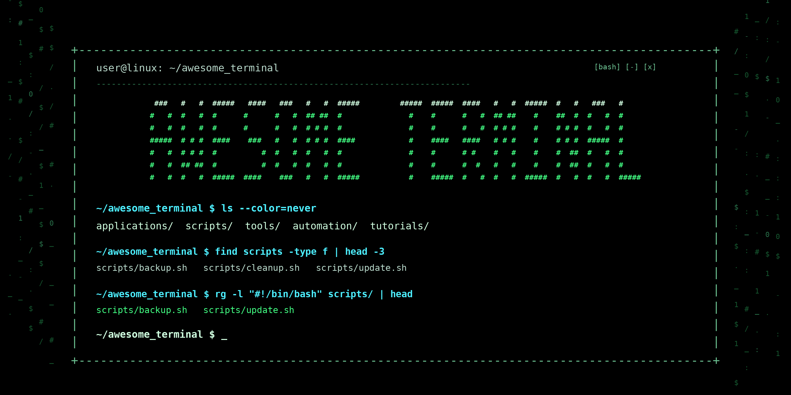

Description
-----------------------------------------------------------------------------------------
This repository contains a collection of command-line applications, shell scripts, and
tutorials for working efficiently in the terminal. It explores practical alternatives to
graphical interfaces, demonstrates useful command-line workflows, and provides scripts
for automating tasks.
The objective of this project is not only to document tools and techniques for future
reference but also to share knowledge with others interested in improving their
command-line skills, simplifying everyday workflows, and making better use of
Unix-like systems.

Repository Structure
-----------------------------------------------------------------------------------------
- `./applications/` A collection of terminal-based applications and command-line tools
  that provide alternatives to graphical software or enhance everyday terminal workflows.

- `./scripts/` Shell scripts for automating tasks and combining command-line
  utilities into reusable workflows.

- `./tutorials/` Tutorials covering tools, commands, and techniques for
  working effectively from the command line.

Disclaimer
-----------------------------------------------------------------------------------------
The tools, scripts, and instructions in this repository are provided for educational and
personal use. Their behavior may vary depending on the operating system, shell, installed
dependencies, and local configuration. Review scripts and commands before executing them,
particularly when they modify files or system settings.

Contributing
-----------------------------------------------------------------------------------------
This repository represents a personal project. However, contributions in the form of
insights, suggestions, or improvements are welcome. Constructive feedback is highly
encouraged and appreciated. Please feel free to open an issue or submit a pull request
if you would like to contribute.

Licensing
-----------------------------------------------------------------------------------------
You are free to use, modify, and distribute the repository contents according to the MIT
license terms. [^4]

Acknowledgements
-----------------------------------------------------------------------------------------
Credits to the developers and maintainers of the open-source command-line tools featured
in this repository, as well as the wider Unix and Linux communities for sharing
knowledge, documentation, and practical solutions. Their contributions make the terminal
a powerful and accessible environment for learning, customization, and automation.
